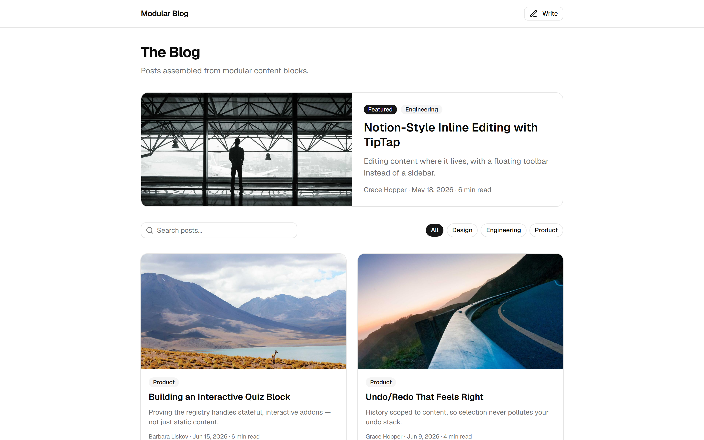
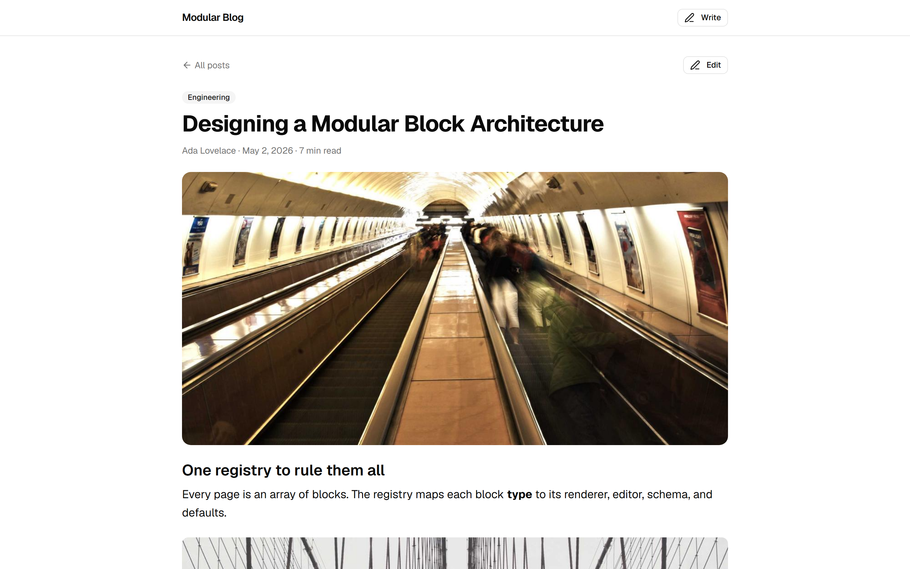
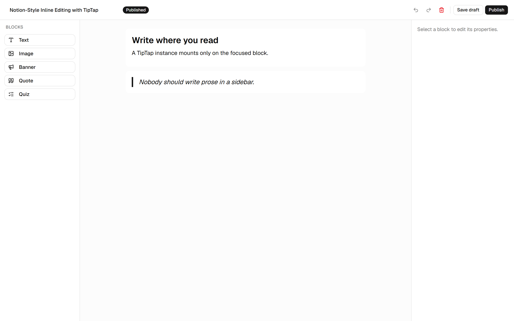

# Modular Blog Platform

A block-based blog where pages are built from reusable, typed content blocks instead of
fixed templates. The reading side is Medium-like, the editing is Notion-like (you type
in place), and pages are assembled Webflow-style from blocks.

Built as a React case study, with the focus on the architecture rather than breadth of
features.

## Highlights

- A block engine where every page is a discriminated union of typed blocks, rendered
  dynamically. A single block registry feeds the palette, renderer, property panel,
  validation and defaults, so adding a block type is one entry.
- Notion-style editor: type content directly on the canvas; the right panel holds
  configuration. Rich text via TipTap (headings, bold/italic, alignment, color, links),
  drag-and-drop reordering (mouse and keyboard), undo/redo, and draft autosave.
- Reader: blog list with search, category filters, a featured post and pagination; a
  detail page that renders the same blocks the editor produced.
- An interactive Quiz block (answer, submit, score) to show the registry can host
  stateful blocks, not only static ones.
- Mock backend with MSW (list/get/create/update/delete) so the editor and reader share
  one data flow without a server.
- TypeScript throughout, with Zod schemas checked against the TS types.

## Screenshots

Building a post in the editor:


| Blog list | Post detail | Editor |
| --- | --- | --- |
|  |  |  |

## Tech stack

React 19, TypeScript, Vite, Tailwind CSS v4, shadcn/ui, Zustand (with zundo and Immer),
React Router, React Hook Form, Zod, TipTap, dnd-kit, MSW, Vitest + Testing Library.

## Getting started

```bash
npm install
npm run dev
```

MSW starts automatically. Other scripts: `build`, `preview`, `test`, `test:run`,
`typecheck`, `lint`.

To see the whole flow: open `/`, hit Write, add a few blocks and type a post, Publish,
then Edit it. Reloading mid-edit restores the local draft.

## How it's put together

### Block engine (`src/blocks/`)

The block model is the core of the project.

- `types.ts`: the `Block` union (text, image, banner, quote, quiz) and `BlogDocument`,
  which carries a `version` for future migrations.
- `schemas.ts`: a Zod schema per block plus a discriminated-union document schema,
  `satisfies`-checked against the TS types.
- `definition.ts` + `registry.ts`: each block exports a `BlockDefinition` (label, icon,
  schema, defaults, views) and is added to the registry. Everything else reads from there.
- `DynamicRenderer.tsx`: looks each block up by type and renders it, keyed by id; unknown
  types fall back to `UnknownBlock`.
- `factory.ts` / `migrate.ts`: create blocks from defaults; stamp the document version.

Each block lives in its own folder (`blocks/text/`, `blocks/quiz/`, etc).

### Editing model

A block can expose two optional editing surfaces: `InlineEdit` (on the canvas) and `Edit`
(right panel). Text and quote are edited inline; image and banner are configured in the
panel. Text formatting lives in the panel and drives the focused TipTap editor through a
small `useActiveEditor` store.

### Editor state (`src/features/editor/`)

Zustand + Immer for the document, zundo for undo/redo. History tracks only the document,
and a reference-equality check keeps selection out of the undo stack. Reordering uses
dnd-kit with a keyboard sensor and move up/down buttons as a non-drag fallback.

### Data (`src/mocks/`, `src/features/blog/`)

MSW intercepts `/api/posts*` against an in-memory store seeded from fixtures, deriving
post metadata (slug, excerpt, cover, reading time) from the title and blocks. The reader
fetches through `api.ts`; the editor saves, publishes and deletes through it. New posts
autosave to `localStorage` until they're saved.

### Performance

Routes are code-split and block editors are lazy, so TipTap and the editor only load on
`/admin`, not in the reader bundle.

## Adding a block

1. Add it to the `Block` union and a Zod schema.
2. Create `blocks/<name>/` with a `Render` and optionally `InlineEdit` / `Edit`.
3. `defineBlock({...})` and add it to the registry.

It then shows up in the palette, renders in the editor and reader, and validates.

## Project structure

```
src/
  blocks/        block engine: types, schemas, registry, renderer + each block
  features/
    editor/      3-panel editor: store, canvas, palette, property panel, persistence
    blog/        reader: list/detail pages, api, filter logic, fixtures
  components/    layout + shared UI (shadcn under components/ui)
  mocks/         MSW handlers + in-memory store
  lib/           utils (cn, sanitize, id, format, url)
  tests/         tests
docs/            PROJECT_PLAN, TECHNICAL_DESIGN, PRODUCTION_READINESS
```

## Testing

58 tests (Vitest + Testing Library) over the parts with real logic: the renderer,
registry/factory, schemas, editor store and undo/redo, inline editing, quiz scoring and
interaction, blog filter/pagination, the API service against MSW, and URL/HTML sanitizing.

```bash
npm run test:run
```

## Limitations

- No real backend; MSW is the API. For a real build it would be limited to dev.
- Image uploads are in-memory object URLs, so they don't survive a refresh.
- Client-side SPA, no SSR/SEO.
- shadcn/ui here uses the current Base UI variant, not Radix.

See [`docs/`](./docs) for the plan, technical design and a production-readiness note.
